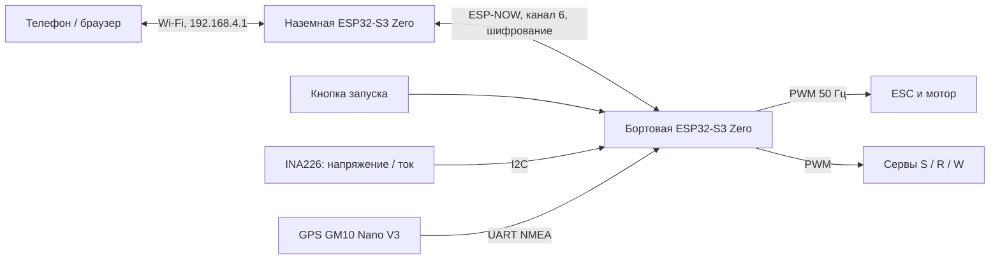
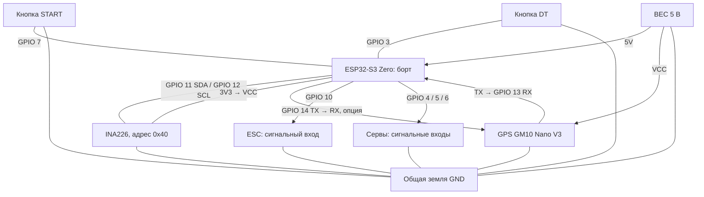
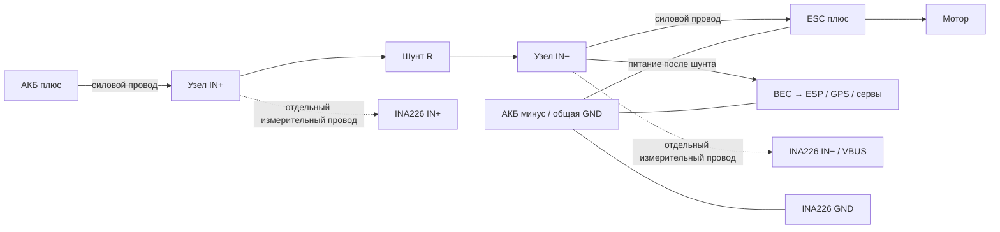
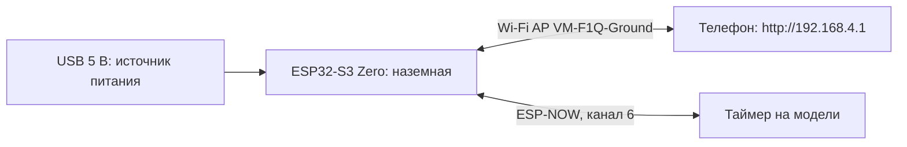

# VM-T1 / F1Q — бортовой таймер и наземный модуль

Ветка **F1Q** добавляет к проекту Мстислава две прошивки для **ESP32-S3 Zero**:
бортовой таймер электромодели F1Q и наземный модуль с веб-настройкой через телефон.
Исходная прошивка для F1A(BCQ) сохранена в [`VM_T1/VM_T1.ino`](VM_T1/VM_T1.ino).
Новые подключения ниже относятся только к прошивке F1Q: переносить на неё всю старую распайку нельзя.

**Статус:** первая версия для стендовой проверки. Обе прошивки компилируются;
программные проверки запуска и отсечек проходят. Загрузка на реальные платы,
калибровка тока, точность энергии и дальность радиосвязи ещё не проверены.
Это не подтверждение соответствия спортивному регламенту F1Q: лимит энергии и
времени задаётся пользователем по актуальным правилам соревнований.

## Возможности

- Запуск по отпусканию тактовой кнопки на борту после удержания минимум 1 секунду.
- Запрет запуска при зажатой кнопке во время включения; ожидание 3 секунд для ESC.
- Настраиваемые длительность мотора, уровень газа PWM, лимит энергии в джоулях,
  минимальное напряжение и максимальный ток.
- Постоянный уровень газа на моторном участке; плавный разгон и многоступенчатый
  профиль газа в этой версии не реализованы.
- Три выхода серв S/R/W: положения ожидания, моторного участка, планирования и DT.
- Отсечка мотора по первому достигнутому лимиту времени/энергии, при ошибке INA226,
  превышении тока, низком напряжении или команде DT.
- Автоматический DT по общему времени от запуска; физический DT-вход на борту.
- Шифрованная ESP-NOW связь между заранее спаренными устройствами, канал 6.
- Наземный веб-сервер: настройка, телеметрия, подтверждение настроек бортом,
  дистанционный DT, последние координаты и ссылка на OpenStreetMap.
- Полётные настройки сохраняются на борту во flash. Во время готовности к запуску,
  работы мотора и планирования запись новых настроек запрещена.

Борт самостоятельно считает энергию и выключает мотор. Телефон и наземный модуль
не участвуют в выполнении временных и энергетических ограничений.
Потеря ESP-NOW не останавливает отсчёт и не запускает мотор заново.

## Покупные модули

| Деталь | Количество | Ссылка и примечание |
|---|---:|---|
| ESP32-S3 Zero | 2 | [Waveshare: плата](https://www.waveshare.com/esp32-s3-zero.htm), [распиновка и документация](https://www.waveshare.com/wiki/ESP32-S3-Zero). Одна на борту, другая на земле. Прошивка рассчитана на 4 МБ Flash, без PSRAM. У клонов проверьте разводку и питание. |
| Модуль INA226 | 1 | [Предложенная плата на Ozon](https://ozon.ru/t/yeM9IzQ), [даташит TI](https://www.ti.com/lit/ds/symlink/ina226.pdf). Нужна именно INA226. Комплектация, шунт и допустимый ток конкретной платы требуют проверки; карточка Ozon недоступна для независимой проверки в этой сессии. |
| Шунт нужного сопротивления и мощности | 1 | Выбирается по фактическому току, расчёт ниже. Пример каталога: [Bourns CSS2H](https://www.bourns.com/products/resistors/current-sense-resistors). Это ссылка на семейство, а не выбранный номинал или совместимый корпус. |
| GPS Flywoo GOKU GM10 Nano V3 | 1, необязательно | [Страница производителя / покупка](https://flywoo.net/products/goku-gm10-nano-v3-gps). По спецификации: **12 × 16 × 4,5 мм, 2,2 г**, питание **3,3–5 В**, UART. Для парсера нужен выход **NMEA, 9600 бод**; фактический режим поставленного модуля проверьте до установки. |
| Тактовая кнопка, нормально разомкнутая | 1 | [Пример семейства Omron B3F](https://components.omron.com/us-en/products/switches/B3F). Подойдёт малогабаритная кнопка без фиксации; соединяем GPIO с GND. |
| Кнопка DT | 1, необязательно | Такая же кнопка без фиксации. |
| ESC с обычным servo PWM | 1 | Подбирается под мотор, аккумулятор и ток. Эта прошивка выдаёт импульсы 50 Гц; DShot и бесколлекторное управление напрямую не поддерживаются. |
| Сервоприводы | 1–3 | Подбираются под механику и питание. Их силовое питание не берётся с вывода 3V3 ESP. |
| BEC / DC-DC для борта | 1 | Стабилизированные 5 В на ESP и, если допустимо, GPS. Вход должен выдерживать полный заряд аккумулятора: **3S LiPo = 12,6 В**, а не только номинальные 11,1 В. Ток выбирается с учётом серв и ESP. |
| USB-источник 5 В | 1 | Питание наземной платы от USB. Дисплей и отдельные радиомодули для неё не нужны. |

GPS не передаёт координаты сам: их получает бортовая ESP и пересылает по ESP-NOW.
Для поиска за пределами радиодальности нужен отдельный дальнобойный канал/маяк;
в этой версии его нет. Маленькая GPS-антенна требует открытого обзора неба:
не закрывайте её аккумулятором, углепластиком и силовой проводкой.

## Общая схема



## Подключение борта

Номера в таблице — **GPIO**, а не порядковый номер площадки платы.
Все сигнальные земли объединить. У ESP32 логика **3,3 В**.

| ESP32-S3 Zero | Подключение | Примечание |
|---|---|---|
| GPIO 4 | Сигнал сервы S | Включена по умолчанию |
| GPIO 5 | Сигнал сервы R | Включается в веб-настройке |
| GPIO 6 | Сигнал сервы W | Включается в веб-настройке |
| GPIO 7 | Кнопка запуска → GND | Внутренняя подтяжка, нажатие = LOW; запуск после отпускания |
| GPIO 3 | Кнопка DT → GND | Внутренняя подтяжка; нажатие выключает мотор и переводит сервы в DT |
| GPIO 10 | Сигнал ESC | Servo PWM 50 Гц, по умолчанию стоп 1000 мкс / работа 1300 мкс |
| GPIO 11 | INA226 SDA | I2C, подтяжки только к 3,3 В |
| GPIO 12 | INA226 SCL | I2C, подтяжки только к 3,3 В |
| 3V3 | INA226 VCC / VS | Питание логики датчика; **не силовой вход измерения** |
| GND | INA226 GND | Общая земля |
| GPIO 13, RX | GPS TX | TX модуля идёт на RX ESP |
| GPIO 14, TX | GPS RX | Необязательно для чтения NMEA; пригодится для настройки GPS |
| 5V от BEC | GPS VCC | Для выбранного GM10 Nano V3 допустимо 3,3–5 В; уровни UART должны быть 3,3 В |
| GND | GPS GND | Общая земля |
| 5V | Выход стабилизатора BEC 5 В | **Аккумулятор 3S напрямую к ESP не подключать** |
| GND | BEC −, ESC −, сервоприводы −, аккумулятор − | Общая земля |

Пины исходного проекта BACK/FRONT и аналоговый VBAT в F1Q не используются.
GPIO 7 теперь служит кнопкой запуска. INA226 настроен на адрес **0x40**;
выставьте адресные перемычки платы согласно её документации.
ALERT в этой версии не подключается, защита реализована опросом датчика.



Плюс серв подключайте к подходящему BEC, а не к GPIO/3V3.
Если ESC уже имеет BEC, используйте один согласованный источник питания;
не соединяйте параллельно выходы двух стабилизаторов без предусмотренной развязки.
При подключении USB учитывайте возможность встречного питания через 5V конкретной платы.

### Силовая цепь и INA226

Измерение — по плюсовому проводу, **high-side**. Направление положительного тока:
аккумулятор → IN+ → шунт → IN− → нагрузка. Входы IN+/IN− — измерительные;
на некоторых модулях силовые клеммы имеют другие надписи, сверяйте разводку.



Здесь через шунт проходит **весь ток модели**, включая BEC, ESP, сервы и GPS.
На платах, где VBUS выделен отдельно, соедините его с узлом **после шунта**;
на платах с уже выполненной перемычкой к IN− дополнительное соединение не нужно.
Прошивка восстанавливает напряжение перед шунтом как `Vbus + Vshunt`.
Если VBUS подключить к IN+, расчёт напряжения будет завышен на падение шунта.

Если используется внешний шунт, штатный нужно убрать: два параллельных шунта
изменят сопротивление и калибровку. Подводы измерения делайте непосредственно
к выводам шунта, чтобы сопротивление силовых проводов не попало в измерение.
Максимальный ток дорожек, клемм и пайки дешёвого модуля не определяется надписью
«36 В, 16 бит»: для большого тока нужен проверенный силовой тракт.

### Выбор и калибровка шунта

У INA226 диапазон падения на шунте примерно **±81,92 мВ**. В настройках оставлен
запас: требуется `Imax × Rshunt ≤ 0,075 В`. Тепловая мощность: `P = I² × R`.
Мощность резистора выбирайте с запасом по даташиту и с учётом охлаждения.

| Пример шунта | Падение при 30 А | Нагрев при 30 А | Вывод |
|---|---:|---:|---|
| 0,01 Ом | 300 мВ | 9 Вт | Не подходит для измерения 30 А INA226 |
| 0,001 Ом | 30 мВ | 0,9 Вт | По диапазону подходит; проверить мощность и силовой монтаж |

«В 10 раз меньше штатного» недостаточно для выбора значения в настройках.
Примеры маркировки: **R100 = 0,1 Ом**, **R010 = 0,01 Ом**, **R001 = 0,001 Ом**.
Поэтому R100 → R010 и R010 → R001 дают совершенно разные диапазоны тока.
Начальные **0,001 Ом в прошивке — пример, не утверждение о вашей плате**.
Пока не отмечено подтверждение калибровки, запуск мотора заблокирован.

1. Установите рассчитанный шунт; проверьте его маркировку и соединения.
2. На известной нагрузке сравните ток с эталонным амперметром. Обычный двухпроводный
   омметр плохо подходит для измерения миллиомного сопротивления.
3. Уточните настройку: `Rновое = Rвведённое × Iпоказанный / Iэталонный`.
4. Проверьте напряжение мультиметром, знак тока и ноль без силовой нагрузки.
5. Проверьте энергию на стабильной нагрузке: `E = U × I × t`, `1 Вт·ч = 3600 Дж`.
6. Только после проверки подтвердите калибровку в веб-интерфейсе.

Ток вычисляется из сырого напряжения шунта с шагом 2,5 мкВ, напряжение VBUS —
с шагом 1,25 мВ. Энергия интегрируется методом трапеций во время работы мотора;
обратный ток не уменьшает расход. Счётчик обнуляется при каждом запуске.
Опрос выполняется каждые 5 мс по свежим преобразованиям. Ошибка чтения, насыщение
датчика или отсутствие свежих данных более 50 мс выключают мотор.
Программная отсечка тока не заменяет защиту силовой цепи от короткого замыкания.

## Наземный модуль

Вторая **ESP32-S3 Zero** подключается к USB 5 В. INA226, GPS и ESC находятся на борту,
к наземной плате дополнительных проводов от них не нужно.



Телефон подключается к **VM-F1Q-Ground**, затем открывает **http://192.168.4.1**.
Пароль создаётся при спаривании и записывается в приватный `Pairing.local.h`.
Подключение к домашнему роутеру не нужно: AP и ESP-NOW работают на одном канале.

Кнопка «Сохранить и передать на борт» записывает параметры в наземную память и
повторяет передачу, пока борт не подтвердит ту же ревизию и содержимое настроек.
До подтверждения старые настройки на борту продолжают действовать.
Без свежей связи с бортом запись из веб-интерфейса запрещена.
Настройки после перезапуска земли читаются с борта при первом соединении.

DT-команда повторяется 2 секунды; проверяйте сообщение о подтверждении бортом.
При потере связи дистанционный DT недоступен, но бортовой DT по времени работает.
Координаты остаются в оперативной памяти наземной платы до её выключения;
после потери связи показывается возраст последней телеметрии и GPS-точки.
Карта требует интернета или заранее сохранённой офлайн-карты на телефоне.

## Сборка и спаривание

Новая прошивка собирается через **PlatformIO**, настройки — в [`platformio.ini`](platformio.ini).
Зафиксированы Espressif32 6.4.0 / Arduino Core 2.0.11, ESP32Servo 1.1.2,
ArduinoJson 7.4.3 и TinyGPSPlus 1.1.0. ESP32Servo закреплена по Git commit тега 1.1.2.
Generic-профиль ESP32-S3 DevKitC используется с переопределением Flash на **4 МБ**,
DIO и таблицей разделов `default.csv`; PSRAM не используется.

```sh
pio run -e f1q_timer
pio run -e f1q_ground
```

Перед первой прошивкой снимите пропеллер. Сигнал газа может иметь другой диапазон
у конкретного ESC: проверьте руководство и режим обычного PWM.
Автоматической калибровки газа максимальным импульсом прошивка не выполняет.

1. Соберите и загрузите обе прошивки без `Pairing.local.h`. Радиосвязь будет выключена,
   наземная точка доступа использует временный пароль `change-this-123`.
2. Откройте последовательный монитор **115200** для каждой платы. Запишите вывод
   **STA MAC**. У наземной платы нужен именно STA MAC, не MAC точки доступа.
3. Создайте приватную конфигурацию из корня репозитория:

   ```sh
   python F1Q/pair.py --timer AA:BB:CC:DD:EE:01 --ground AA:BB:CC:DD:EE:02
   ```

   Адреса в примере замените реальными. Скрипт создаёт случайные PMK/LMK по 16 байт
   и пароль AP в `F1Q/common/Pairing.local.h`. Файл исключён из Git; храните его
   локально и используйте один и тот же файл при сборке обеих плат.
4. Пересоберите и загрузите обе прошивки:

   ```sh
   pio run -e f1q_timer -t upload --upload-port /dev/ttyACM0
   pio run -e f1q_ground -t upload --upload-port /dev/ttyACM1
   ```

   Порты — примеры. На Windows используйте соответствующие `COM…`.
   При необходимости входа в загрузчик используйте BOOT/RESET по инструкции платы.
5. Подключите телефон к точке доступа с приватным паролем, откройте веб-интерфейс.
6. Настройте сопротивление шунта, ток, напряжение, лимиты энергии/времени и импульсы ESC.
   Для 3S стартовое минимальное напряжение — 9 В; это пример, подберите порог под
   свой аккумулятор и просадку. Для других батарей задайте собственный порог;
   автоматического определения числа банок нет. Пределы INA226 не отменяют
   ограничений ESC, BEC и конкретного модуля.
7. Убедитесь, что борт подтвердил настройки; проверьте запуск, отсечки и DT без пропеллера.

Готовые универсальные `.bin` не публикуются: рабочие образы должны содержать MAC
и приватные ключи конкретной пары. При замене платы повторите спаривание обеих.

## Порядок запуска

1. Включить модель, отпустить кнопку запуска, подождать минимум 3 секунды.
2. Проверить настройки, калибровку и положение серв. Для работы нужны INA226 и
   сохранённая конфигурация с подтверждением шунта; GPS для запуска не обязателен.
3. Нажать кнопку на борту и удерживать минимум 1 секунду.
4. Отпустить кнопку: начинается моторный участок и общий отсчёт полёта.
5. Мотор выключается по первому лимиту, сервы переходят в планирование.
6. По общему времени или команде DT сервы переходят в DT.
7. Следующий запуск возможен после DT/ошибки новым нажатием и отпусканием кнопки;
   в состоянии планирования повторный запуск заблокирован.

Начальные параметры: мотор **25 с**, стоп **1000 мкс**, работа **1300 мкс**,
общий DT **180 с**, минимум **9 В**, максимум **30 А**, энергия **0 Дж**
(энергетический лимит выключен, временной остаётся). Фактические параметры нужно
задать под модель; исходная конфигурация не разрешает запуск до калибровки.

## Проверки

14 ноября 2026: обе цели PlatformIO собраны под ESP32-S3.
Программные тесты выполняют настоящие `setup()` / `loop()` бортовой прошивки с
имитацией GPIO, INA226, PWM и радио. Они проверяют запуск по отпусканию, блокировку
зажатой при включении кнопки, лимиты времени/энергии/тока/напряжения, отказ датчика,
местный и дистанционный DT, запрет смены настроек в полёте и устаревших ревизий.
Веб-тест с имитацией API проверяет мобильную страницу, отправку настроек,
подтверждения ревизии и DT, ссылку GPS и отсутствие ошибок JavaScript.

```sh
g++ -std=c++11 -Wall -Wextra -Werror F1Q/tests/model_test.cpp -o /tmp/f1q-model-test
/tmp/f1q-model-test
g++ -std=c++17 -Wall -Wextra -Werror -IF1Q/tests/fakes F1Q/tests/flight_test.cpp -o /tmp/f1q-flight-test
/tmp/f1q-flight-test
```

Веб-тест (нужны Node.js, пакет `playwright` и установленный для него Chromium):

```sh
node F1Q/tests/browser_test.cjs
# Для системного Chromium:
CHROMIUM_PATH=/usr/bin/chromium node F1Q/tests/browser_test.cjs
```

Стендовые испытания обязательны для подтверждения задержек отсечки, точности,
помехоустойчивости, диапазонов ESC/серв и реальной дальности. Старые PDF описывают
исходный буксировочный таймер, а не новую электрическую часть F1Q.

## Файлы и исходный проект

- [`F1Q/timer/main.cpp`](F1Q/timer/main.cpp) — борт.
- [`F1Q/ground/main.cpp`](F1Q/ground/main.cpp) — наземный веб-сервер.
- [`F1Q/common/Model.h`](F1Q/common/Model.h) — настройки и протокол.
- [`F1Q/common/Radio.h`](F1Q/common/Radio.h) — ESP-NOW и очередь приёма.
- [`F1Q/pair.py`](F1Q/pair.py) — создание приватных параметров пары.
- [`VM_T1/VM_T1.ino`](VM_T1/VM_T1.ino) — сохранённый исходный таймер Мстислава.
- [Исходное руководство F1A(BCQ)](VM-T1_Руководство_пользователя.pdf).
- [Исходная распайка F1A(BCQ)](Распайка.pdf).

Исходный Arduino-скетч можно собирать отдельно в Arduino IDE с Core 2.0.11,
ESP32Servo 1.1.2 и ArduinoJson 7.4.3: ESP32S3 Dev Module, USB CDC On Boot Enabled,
Flash Mode DIO, PSRAM Disabled. PlatformIO-цели выше собирают только новый F1Q.

## Лицензия

**Автор исходного проекта — Мстислав.** Исходник был подготовлен к публикации
с разрешения автора. Расширение F1Q добавлено в 2026 году; исходная прошивка сохранена.
Код и документация — [Apache License 2.0](LICENSE), авторство — [NOTICE](NOTICE),
зависимости — [LICENSING.md](LICENSING.md). Сторонние библиотеки сохраняют свои лицензии.
