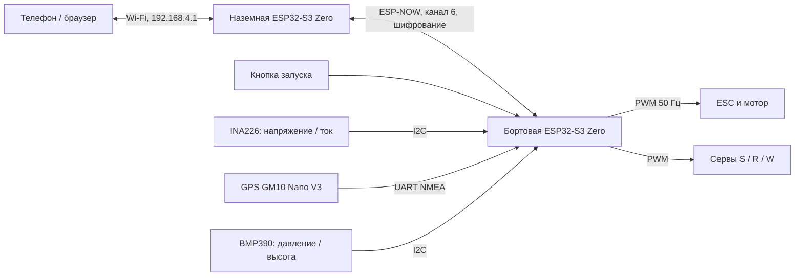
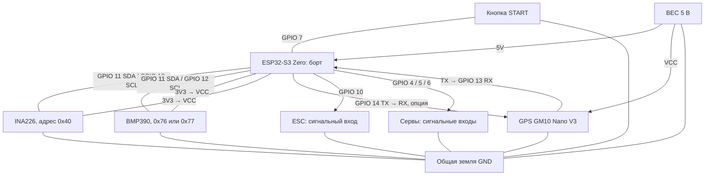
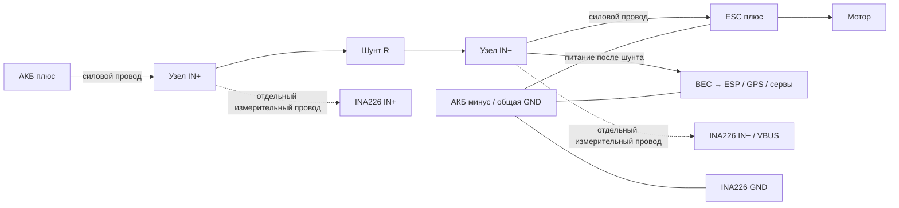
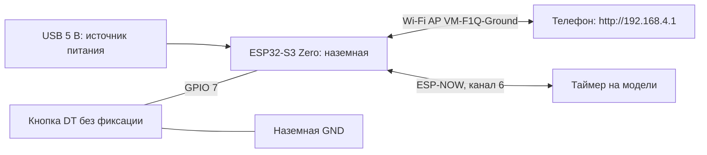

# VM-T1 / F1Q — бортовой таймер и наземный модуль

Ветка **F1Q** добавляет к проекту Мстислава две прошивки для **ESP32-S3 Zero**:
бортовой таймер электромодели F1Q и наземный модуль с веб-настройкой через телефон.
Исходная прошивка для F1A(BCQ) сохранена в [`VM_T1/VM_T1.ino`](VM_T1/VM_T1.ino).
Новые подключения ниже относятся только к прошивке F1Q: переносить на неё всю старую распайку нельзя.

**Статус:** первая версия для стендовой проверки. Обе прошивки компилируются;
программные проверки запуска и отсечек проходят. Загрузка на реальные платы,
калибровка тока, точность энергии и дальность радиосвязи ещё не проверены.
Это не подтверждение соответствия спортивному регламенту F1Q: лимит энергии и
времени задаётся пользователем по актуальным правилам соревнований.

## Возможности

- Запуск по отпусканию тактовой кнопки на борту после удержания минимум 1 секунду.
- Запрет запуска при зажатой кнопке во время включения; ожидание 3 секунд для ESC.
- Настраиваемые длительность мотора, уровень газа PWM, лимит энергии в джоулях,
  минимальное напряжение и максимальный ток.
- Постоянный уровень газа на моторном участке; плавный разгон и многоступенчатый
  профиль газа в этой версии не реализованы.
- Три выхода серв S/R/W: положения ожидания, моторного участка, планирования и DT.
- Отсечка мотора по первому достигнутому лимиту времени/энергии, при ошибке INA226,
  превышении тока, низком напряжении или команде DT.
- Автоматический DT по общему времени от запуска; физическая кнопка DT **на земле**.
- Шифрованная ESP-NOW связь между заранее спаренными устройствами, канал 6.
- Наземный веб-сервер: настройка, телеметрия, подтверждение настроек бортом,
  дистанционный DT, последние координаты, высоты и ссылка на OpenStreetMap.
- BMP390: давление и высота относительно старта; GPS: высота над уровнем моря и от старта.
- Бортовой журнал 4 Гц: земля от включения и полёт в одном журнале, до 34 минут.
- Наземный `latest.csv` с принятыми данными последнего полёта, выгрузка из браузера.
- Полётные настройки сохраняются на борту во flash. Во время готовности к запуску,
  работы мотора и планирования запись новых настроек запрещена.

Борт самостоятельно считает энергию и выключает мотор. Телефон и наземный модуль
не участвуют в выполнении временных и энергетических ограничений.
Потеря ESP-NOW не останавливает отсчёт и не запускает мотор заново.

Цель по дальности — **1–3 км в воздухе**. Сравнение программных и аппаратных вариантов:
[ESP-NOW LR, антенны, SX1262, ExpressLRS](F1Q/RADIO_RANGE.md).
Эти радиорасширения пока не реализованы и не проверены в поле.

## Покупные модули

| Деталь | Количество | Ссылка и примечание |
|---|---:|---|
| ESP32-S3 Zero | 2 | [Waveshare: плата](https://www.waveshare.com/esp32-s3-zero.htm), [распиновка и документация](https://www.waveshare.com/wiki/ESP32-S3-Zero). Одна на борту, другая на земле. Прошивка рассчитана на 4 МБ Flash, без PSRAM. У клонов проверьте разводку и питание. |
| Модуль INA226 | 1 | [Предложенная плата на Ozon](https://ozon.ru/t/yeM9IzQ), [даташит TI](https://www.ti.com/lit/ds/symlink/ina226.pdf). Нужна именно INA226. Комплектация, шунт и допустимый ток конкретной платы требуют проверки; карточка Ozon недоступна для независимой проверки в этой сессии. |
| Барометр BMP390 | 1 | [Готовый модуль Adafruit BMP390](https://www.adafruit.com/product/4816), [датчик Bosch](https://www.bosch-sensortec.com/products/environmental-sensors/pressure-sensors/bmp390/). Для лёгкой модели можно взять меньшую совместимую плату, проверив питание и подтяжки I2C. Прошивка использует BMP3XX; BMP280/BME280 с ней не взаимозаменяемы. |
| Шунт нужного сопротивления и мощности | 1 | Выбирается по фактическому току, расчёт ниже. Пример каталога: [Bourns CSS2H](https://www.bourns.com/products/resistors/current-sense-resistors). Это ссылка на семейство, а не выбранный номинал или совместимый корпус. |
| GPS Flywoo GOKU GM10 Nano V3 | 1, необязательно | [Страница производителя / покупка](https://flywoo.net/products/goku-gm10-nano-v3-gps). По спецификации: **12 × 16 × 4,5 мм, 2,2 г**, питание **3,3–5 В**, UART. Для парсера нужен выход **NMEA, 9600 бод**; фактический режим поставленного модуля проверьте до установки. |
| Тактовая кнопка, нормально разомкнутая | 1 | [Пример семейства Omron B3F](https://components.omron.com/us-en/products/switches/B3F). Подойдёт малогабаритная кнопка без фиксации; соединяем GPIO с GND. |
| Кнопка DT на наземном модуле | 1 | Тактовая кнопка без фиксации: GPIO 7 наземной ESP → кнопка → GND. |
| ESC с обычным servo PWM | 1 | Подбирается под мотор, аккумулятор и ток. Эта прошивка выдаёт импульсы 50 Гц; DShot и бесколлекторное управление напрямую не поддерживаются. |
| Сервоприводы | 1–3 | Подбираются под механику и питание. Их силовое питание не берётся с вывода 3V3 ESP. |
| BEC / DC-DC для борта | 1 | Стабилизированные 5 В на ESP и, если допустимо, GPS. Вход должен выдерживать полный заряд аккумулятора: **3S LiPo = 12,6 В**, а не только номинальные 11,1 В. Ток выбирается с учётом серв и ESP. |
| USB-источник 5 В | 1 | Питание наземной платы от USB. Дисплей и отдельные радиомодули для неё не нужны. |

GPS не передаёт координаты сам: их получает бортовая ESP и пересылает по ESP-NOW.
Для поиска за пределами радиодальности нужен отдельный дальнобойный канал/маяк;
в этой версии его нет. Маленькая GPS-антенна требует открытого обзора неба:
не закрывайте её аккумулятором, углепластиком и силовой проводкой.

## Общая схема



## Подключение борта

Номера в таблице — **GPIO**, а не порядковый номер площадки платы.
Все сигнальные земли объединить. У ESP32 логика **3,3 В**.

| ESP32-S3 Zero | Подключение | Примечание |
|---|---|---|
| GPIO 4 | Сигнал сервы S | Включена по умолчанию |
| GPIO 5 | Сигнал сервы R | Включается в веб-настройке |
| GPIO 6 | Сигнал сервы W | Включается в веб-настройке |
| GPIO 7 | Кнопка запуска → GND | Внутренняя подтяжка, нажатие = LOW; запуск после отпускания |
| GPIO 3 | Не используется в F1Q | Кнопка DT расположена на наземной плате |
| GPIO 10 | Сигнал ESC | Servo PWM 50 Гц, по умолчанию стоп 1000 мкс / работа 1300 мкс |
| GPIO 11 | INA226 SDA и BMP390 SDA | I2C, подтяжки только к 3,3 В |
| GPIO 12 | INA226 SCL и BMP390 SCL | I2C, подтяжки только к 3,3 В |
| 3V3 | INA226 VCC / VS, BMP390 VCC/VIN | Питание логики датчика; **не силовой вход измерения** |
| GND | INA226 GND, BMP390 GND | Общая земля |
| GPIO 13, RX | GPS TX | TX модуля идёт на RX ESP |
| GPIO 14, TX | GPS RX | Необязательно для чтения NMEA; пригодится для настройки GPS |
| 5V от BEC | GPS VCC | Для выбранного GM10 Nano V3 допустимо 3,3–5 В; уровни UART должны быть 3,3 В |
| GND | GPS GND | Общая земля |
| 5V | Выход стабилизатора BEC 5 В | **Аккумулятор 3S напрямую к ESP не подключать** |
| GND | BEC −, ESC −, сервоприводы −, аккумулятор − | Общая земля |

Пины исходного проекта BACK/FRONT и аналоговый VBAT в F1Q не используются.
GPIO 7 теперь служит кнопкой запуска. INA226 настроен на адрес **0x40**;
выставьте адресные перемычки платы согласно её документации.
BMP390 подключается параллельно INA226: SDA GPIO 11, SCL GPIO 12, питание 3,3 В, общая GND.
Адрес BMP390 — **0x76 или 0x77** (прошивка пробует оба); с INA226 0x40 конфликта нет.
На плате BMP390 выберите I2C: CS/CSB должен иметь высокий уровень согласно её схеме,
SDO задаёт адрес. Дополнительные подтяжки ставьте только если они нужны: на модулях
они часто уже есть. Барометр разместите вдали от струи винта и нагрева ESC/BEC,
с доступом атмосферного давления и защитой от прямого набегающего потока.

ALERT в этой версии не подключается, защита реализована опросом датчика.



Плюс серв подключайте к подходящему BEC, а не к GPIO/3V3.
Если ESC уже имеет BEC, используйте один согласованный источник питания;
не соединяйте параллельно выходы двух стабилизаторов без предусмотренной развязки.
При подключении USB учитывайте возможность встречного питания через 5V конкретной платы.

### Силовая цепь и INA226

Измерение — по плюсовому проводу, **high-side**. Направление положительного тока:
аккумулятор → IN+ → шунт → IN− → нагрузка. Входы IN+/IN− — измерительные;
на некоторых модулях силовые клеммы имеют другие надписи, сверяйте разводку.



Здесь через шунт проходит **весь ток модели**, включая BEC, ESP, сервы и GPS.
На платах, где VBUS выделен отдельно, соедините его с узлом **после шунта**;
на платах с уже выполненной перемычкой к IN− дополнительное соединение не нужно.
Прошивка восстанавливает напряжение перед шунтом как `Vbus + Vshunt`.
Если VBUS подключить к IN+, расчёт напряжения будет завышен на падение шунта.

Если используется внешний шунт, штатный нужно убрать: два параллельных шунта
изменят сопротивление и калибровку. Подводы измерения делайте непосредственно
к выводам шунта, чтобы сопротивление силовых проводов не попало в измерение.
Максимальный ток дорожек, клемм и пайки дешёвого модуля не определяется надписью
«36 В, 16 бит»: для большого тока нужен проверенный силовой тракт.

### Выбор и калибровка шунта

У INA226 диапазон падения на шунте примерно **±81,92 мВ**. В настройках оставлен
запас: требуется `Imax × Rshunt ≤ 0,075 В`. Тепловая мощность: `P = I² × R`.
Мощность резистора выбирайте с запасом по даташиту и с учётом охлаждения.

| Пример шунта | Падение при 30 А | Нагрев при 30 А | Вывод |
|---|---:|---:|---|
| 0,01 Ом | 300 мВ | 9 Вт | Не подходит для измерения 30 А INA226 |
| 0,001 Ом | 30 мВ | 0,9 Вт | По диапазону подходит; проверить мощность и силовой монтаж |

«В 10 раз меньше штатного» недостаточно для выбора значения в настройках.
Примеры маркировки: **R100 = 0,1 Ом**, **R010 = 0,01 Ом**, **R001 = 0,001 Ом**.
Поэтому R100 → R010 и R010 → R001 дают совершенно разные диапазоны тока.
Начальные **0,001 Ом в прошивке — пример, не утверждение о вашей плате**.
Пока не отмечено подтверждение калибровки, запуск мотора заблокирован.

1. Установите рассчитанный шунт; проверьте его маркировку и соединения.
2. На известной нагрузке сравните ток с эталонным амперметром. Обычный двухпроводный
   омметр плохо подходит для измерения миллиомного сопротивления.
3. Уточните настройку: `Rновое = Rвведённое × Iпоказанный / Iэталонный`.
4. Проверьте напряжение мультиметром, знак тока и ноль без силовой нагрузки.
5. Проверьте энергию на стабильной нагрузке: `E = U × I × t`, `1 Вт·ч = 3600 Дж`.
6. Только после проверки подтвердите калибровку в веб-интерфейсе.

Ток вычисляется из сырого напряжения шунта с шагом 2,5 мкВ, напряжение VBUS —
с шагом 1,25 мВ. Энергия интегрируется методом трапеций во время работы мотора;
обратный ток не уменьшает расход. Счётчик обнуляется при каждом запуске.
Опрос выполняется каждые 5 мс по свежим преобразованиям. Ошибка чтения, насыщение
датчика или отсутствие свежих данных более 50 мс выключают мотор.
Программная отсечка тока не заменяет защиту силовой цепи от короткого замыкания.

## Наземный модуль

Вторая **ESP32-S3 Zero** подключается к USB 5 В. INA226, GPS и ESC находятся на борту,
к наземной плате дополнительных проводов от них не нужно. На наземной плате подключите кнопку DT
между **GPIO 7 и GND**; включена внутренняя подтяжка. На борту GPIO 7 остаётся
кнопкой запуска: это две разные кнопки на двух платах.

Нажатие DT на земле отправляет команду выключить мотор и применить положения DT
**без телефона и браузера**. Обработчик работает в отдельной задаче с приоритетом
выше веб-сервера и записи наземного CSV: опрос 5 мс, подавление дребезга 20 мс.
Отправка начинается по нажатию, а не по отпусканию. Зажатая при включении кнопка
не вызывает DT: её нужно отпустить и нажать снова. Во время подготовки земли
и до настройки ESP-NOW кнопка ещё не обеспечивает связь с бортом.



Телефон подключается к **VM-F1Q-Ground**, затем открывает **http://192.168.4.1**.
Пароль создаётся при спаривании и записывается в приватный `Pairing.local.h`.
Подключение к домашнему роутеру не нужно: AP и ESP-NOW работают на одном канале.

Кнопка «Сохранить и передать на борт» записывает параметры в наземную память и
повторяет передачу, пока борт не подтвердит ту же ревизию и содержимое настроек.
До подтверждения старые настройки на борту продолжают действовать.
Без свежей связи с бортом запись из веб-интерфейса запрещена.
Настройки после перезапуска земли читаются с борта при первом соединении.

Физическая кнопка и веб-кнопка используют один передатчик DT: повторы каждые 100 мс
в течение 2 секунд. Состояние DT подтверждается обратной телеметрией; отсутствие
подтверждения нельзя считать выполнением команды. Веб-кнопка остаётся дополнительной.
Обработка не зависит от HTTP, но задержку реальной доставки по радио и влияние
операций flash нужно проверить на платах.
При потере связи дистанционный DT недоступен, но бортовой DT по времени работает.
Принятые координаты, обе высоты и другие данные полёта пишутся на земле в единственный
`latest.csv`. Новый полёт заменяет его; журнал начинается с первого принятого пакета
моторного участка, а предстартовые показания сохраняет бортовой журнал.
При первом использовании нажмите «Подготовить память журнала»: автоматического
форматирования при ошибке монтирования нет. Форматирование немонтируемой памяти
может уничтожить прежние данные и требует подтверждения. При заполнении запись
останавливается, старые строки не затираются. Сброс буфера — раз в секунду; при
резком отключении земли последняя секунда может потеряться. CSV выгружается после
полёта либо после 15 секунд без связи. На экране последние координаты остаются в RAM;
после потери связи показывается возраст последней телеметрии и GPS-точки.
Карта требует интернета или заранее сохранённой офлайн-карты на телефоне.

### Мониторинг бортового аккумулятора

INA226 непрерывно измеряет напряжение аккумулятора: до запуска, на моторном
участке и после отсечки. Дополнительный делитель к аналоговому входу не нужен.
Используется напряжение **перед шунтом**: `Vbus + Vshunt`, подключение VBUS — как
на силовой схеме выше. Напряжение передаётся на землю и записывается в `latest.csv`.
На странице есть отдельная строка «Бортовой аккумулятор», текущие вольты,
предупреждение ниже настроенного порога и признак отсутствия свежих данных.
При отсутствии связи более 2 секунд или ошибке INA226 старое значение не выдаётся
за текущий заряд. Процент заряда по напряжению не вычисляется: он зависит от
типа батареи, числа банок и нагрузки.

Порог `minVoltageV` задаётся для всего аккумулятора, а не одной банки. До запуска
напряжение ниже порога запрещает включение мотора; в моторном режиме вызывает
автономную отсечку. Эти проверки выполняются на борту без участия наземного модуля.
Бортовой барометрический журнал содержит высоты/давление; напряжение записывается
в наземный CSV телеметрии.

## Высоты и бортовой журнал

Передаются три разные величины:

- **GPS MSL** — высота над средним уровнем моря из NMEA GGA; это не высота над землёй.
- **GPS от старта** — разность с высотой GPS в момент запуска, если тогда был свежий отсчёт.
- **Барометр от старта** — по отношению текущего давления к давлению перед запуском:
  `h = 44330 × (1 − (p / p0)^0,19029495)`.

Давление до запуска сохраняется всегда при исправном BMP390; нулевая относительная
высота устанавливается при старте. Отсутствие датчика/фикса не выдаётся за высоту 0:
передаются флаги достоверности и возраст измерений. GPS-высота устаревает через 2 с,
барометр — через 0,5 с. Отказ барометра не выключает мотор: моторные отсечки зависят
от INA226 и таймера. Барометр — в отдельной задаче; ожидание его преобразования не
блокирует основной цикл чтения кнопки и управления мотором.

### Один журнал: от питания через землю к полёту

**Пользователю доступен только последний начатый полёт**, одним CSV. Внутри flash
две служебные области: сохранённый последний полёт и черновик нового включения.
Это не архив полётов. Обычное включение и подключение USB **не удаляют** последний
полёт: новые наземные показания пишутся в черновик. При старте мотора черновик
становится новым последним полётом; его предстартовые строки сохраняются.
Если включили питание, но не летали, предыдущий полёт остаётся последним.

Запись запускается автоматически при инициализации, до разрешения запуска мотора,
с периодом **250 мс (4 Гц)**. До готовности датчика строки имеют недостоверный флаг.
Одна запись — **32 байта**, блок — **256 КиБ**, вместимость **8191 запись**, около
**34 мин 8 с** от начала записи. Это больше требуемых 15 минут. Лимит относится к
общему времени земли и полёта. Если блок заполнился ещё до запуска, он не заменяет прежний полёт при старте:
полёт продолжает работать, но для нового полного журнала нужно перезапустить питание.
При заполнении запись останавливается; начало
журнала не перезаписывается кольцевым буфером. Для долгого ожидания на земле
учитывайте этот общий предел; это не 34 минуты дополнительно после старта.

Стирание только черновой области выполняется **до готовности к запуску**, один раз
на включение. В обработчике отпускания кнопки нет операций с flash: сначала выдаётся
PWM мотору, затем отправляется уведомление фоновой задаче журнала. Она записывает
небольшую стартовую отметку без стирания. Если питание пропадёт до её фиксации,
последним останется прежний журнал. Достоверность отметки и каждой строки проверяется CRC.

Пока кнопка запуска нажата / таймер готов к отпусканию, запись flash приостановлена,
а показания копятся в RAM (до 64 секунд). После старта фоновая задача выгружает их.
При необычно долгом удержании свыше этого буфера возможен пропуск: следующая строка
получает `reserved=1` во внутреннем формате; временные метки также показывают разрыв.
Это программное разделение задач, **не доказанная гарантия нулевой задержки**:
общую задержку кнопка → PWM и влияние программирования flash ещё нужно измерить
на плате. В полёте стирания и файловой системы на борту нет.

В одном включении разрешён один запуск мотора, чтобы журнал не содержал два полёта.
Для следующего вылета перезапустите питание; при таком перезапуске старый полёт
сохраняется до фактического нового старта.

### Выгрузка бортового журнала

Подключите USB и откройте монитор 115200 с переводом строки. Перезапуск от USB
без нового запуска мотора не уничтожает последний полёт.

```text
BARO LIST
BARO CSV
```

`BARO CSV` выдаёт **единственный последний начатый полёт**, включая давление на земле
с текущего для него включения. Выгрузка при ARMED/MOTOR/GLIDE запрещена, чтобы
блокирующий USB-вывод не задержал управление. Запись барометра при выгрузке идёт
в отдельной задаче. Пока не было первого старта, сохранённого полёта ещё нет.

Поля: uptime (мс от запуска ПО), давление (Па), барометрическая высота от старта,
GPS MSL, GPS от старта, возраст давления, флаги, состояние и причина отсечки.
Флаги: bit0 — свежее давление, bit1 — барометрическая высота от старта доступна,
bit2 — свежая высота GPS, bit3 — относительная GPS-высота доступна. Время запуска
мотора находится в заголовке; отсутствующие относительные высоты определяются по
флагам. Сырые давления до запуска позволяют рассчитать высоту земли позже.
CRC обрывает экспорт на первой незавершённой/повреждённой строке.

Веб-выгрузка полного **бортового** журнала по радио пока не реализована: браузер
скачивает только наземный `latest.csv`. Независимая бортовая запись сохраняет давление
даже при потере всех радиопакетов. Формат flash и USB-экспорт —
[`OnboardBaroLog.h`](F1Q/timer/OnboardBaroLog.h).

## Сборка и спаривание

Новая прошивка собирается через **PlatformIO**, настройки — в [`platformio.ini`](platformio.ini).
Зафиксированы Espressif32 6.4.0 / Arduino Core 2.0.11, ESP32Servo 1.1.2,
ArduinoJson 7.4.3, TinyGPSPlus 1.1.0, Adafruit BMP3XX 2.1.6. ESP32Servo закреплена по Git commit тега 1.1.2.
Generic-профиль ESP32-S3 DevKitC используется с переопределением Flash на **4 МБ**,
DIO; PSRAM не используется. У земли разделы `default.csv` (LittleFS для CSV),
у борта — `F1Q/timer/partitions.csv` с отдельным разделом сырого барометрического
журнала. После этого обновления нужно загрузить таблицу разделов, а не только приложение.

```sh
pio run -e f1q_timer
pio run -e f1q_ground
```

Перед первой прошивкой снимите пропеллер. Сигнал газа может иметь другой диапазон
у конкретного ESC: проверьте руководство и режим обычного PWM.
Автоматической калибровки газа максимальным импульсом прошивка не выполняет.

1. Соберите и загрузите обе прошивки без `Pairing.local.h`. Радиосвязь будет выключена,
   наземная точка доступа использует временный пароль `change-this-123`.
2. Откройте последовательный монитор **115200** для каждой платы. Запишите вывод
   **STA MAC**. У наземной платы нужен именно STA MAC, не MAC точки доступа.
3. Создайте приватную конфигурацию из корня репозитория:

   ```sh
   python F1Q/pair.py --timer AA:BB:CC:DD:EE:01 --ground AA:BB:CC:DD:EE:02
   ```

   Адреса в примере замените реальными. Скрипт создаёт случайные PMK/LMK по 16 байт
   и пароль AP в `F1Q/common/Pairing.local.h`. Файл исключён из Git; храните его
   локально и используйте один и тот же файл при сборке обеих плат.
4. Пересоберите и загрузите обе прошивки:

   ```sh
   pio run -e f1q_timer -t upload --upload-port /dev/ttyACM0
   pio run -e f1q_ground -t upload --upload-port /dev/ttyACM1
   ```

   Порты — примеры. На Windows используйте соответствующие `COM…`.
   При необходимости входа в загрузчик используйте BOOT/RESET по инструкции платы.
5. Подключите телефон к точке доступа с приватным паролем, откройте веб-интерфейс.
6. Настройте сопротивление шунта, ток, напряжение, лимиты энергии/времени и импульсы ESC.
   Для 3S стартовое минимальное напряжение — 9 В; это пример, подберите порог под
   свой аккумулятор и просадку. Для других батарей задайте собственный порог;
   автоматического определения числа банок нет. Пределы INA226 не отменяют
   ограничений ESC, BEC и конкретного модуля.
7. Убедитесь, что борт подтвердил настройки; проверьте запуск, отсечки и DT без пропеллера.

Готовые универсальные `.bin` не публикуются: рабочие образы должны содержать MAC
и приватные ключи конкретной пары. При замене платы повторите спаривание обеих.

## Порядок запуска

1. Включить модель, отпустить кнопку запуска, подождать минимум 3 секунды.
2. Проверить настройки, калибровку и положение серв. Для работы нужны INA226 и
   сохранённая конфигурация с подтверждением шунта; GPS для запуска не обязателен.
3. Нажать кнопку на борту и удерживать минимум 1 секунду.
4. Отпустить кнопку: начинается моторный участок и общий отсчёт полёта.
5. Мотор выключается по первому лимиту, сервы переходят в планирование.
6. По общему времени или команде DT сервы переходят в DT.
7. Следующий полёт — после перезапуска питания. Один запуск на включение;
   журнал предыдущего полёта сохраняется до следующего фактического запуска.

Начальные параметры: мотор **25 с**, стоп **1000 мкс**, работа **1300 мкс**,
общий DT **180 с**, минимум **9 В**, максимум **30 А**, энергия **0 Дж**
(энергетический лимит выключен, временной остаётся). Фактические параметры нужно
задать под модель; исходная конфигурация не разрешает запуск до калибровки.

## Проверки

17 ноября 2026: обе цели PlatformIO собраны под ESP32-S3.
Программная имитация flash проверяет сохранение прошлого полёта при включении,
переключение черновика после PWM, сохранение предстартовых строк, отсутствие
стирания/записи при удержании кнопки и корректность CRC.
Программные тесты выполняют настоящие `setup()` / `loop()` бортовой прошивки с
имитацией GPIO, INA226, PWM и радио. Они проверяют запуск по отпусканию, блокировку
зажатой при включении кнопки, лимиты времени/энергии/тока/напряжения, отказ датчика,
DT с земли и отсутствие реакции на бывший бортовой DT-вход, запрет смены настроек в полёте и устаревших ревизий,
GPS/барометрические высоты и блокировку повторного запуска в одном включении.
Веб-тест с имитацией API проверяет мобильную страницу, отправку настроек,
подтверждения ревизии и DT, ссылку GPS и отсутствие ошибок JavaScript.

```sh
g++ -std=c++11 -Wall -Wextra -Werror F1Q/tests/model_test.cpp -o /tmp/f1q-model-test
/tmp/f1q-model-test
g++ -std=c++17 -Wall -Wextra -Werror -IF1Q/tests/fakes F1Q/tests/flight_test.cpp -o /tmp/f1q-flight-test
/tmp/f1q-flight-test
```

Проверка физической кнопки земли (дребезг, повторы, включение с зажатой кнопкой):

```sh
g++ -std=c++11 -Wall -Wextra -Werror F1Q/tests/dt_button_test.cpp -o /tmp/f1q-dt-test
/tmp/f1q-dt-test
```

Дополнительные проверки размера журнала, CRC, стартовой отметки и накопителя:

```sh
g++ -std=c++11 -Wall -Wextra -Werror F1Q/tests/barolog_test.cpp -o /tmp/f1q-barolog-test
/tmp/f1q-barolog-test
g++ -std=c++17 -Wall -Wextra -Werror -IF1Q/tests/log_fakes F1Q/tests/onboard_storage_test.cpp -o /tmp/f1q-storage-test
/tmp/f1q-storage-test
```

Веб-тест (нужны Node.js, пакет `playwright` и установленный для него Chromium):

```sh
node F1Q/tests/browser_test.cjs
# Для системного Chromium:
CHROMIUM_PATH=/usr/bin/chromium node F1Q/tests/browser_test.cjs
```

Стендовые испытания обязательны для подтверждения задержек отсечки, точности,
помехоустойчивости, диапазонов ESC/серв и реальной дальности. Старые PDF описывают
исходный буксировочный таймер, а не новую электрическую часть F1Q.

## Файлы и исходный проект

- [`F1Q/timer/main.cpp`](F1Q/timer/main.cpp) — борт.
- [`F1Q/ground/main.cpp`](F1Q/ground/main.cpp) — наземный веб-сервер.
- [`F1Q/common/Model.h`](F1Q/common/Model.h) — настройки и протокол.
- [`F1Q/common/Radio.h`](F1Q/common/Radio.h) — ESP-NOW и очередь приёма.
- [`F1Q/pair.py`](F1Q/pair.py) — создание приватных параметров пары.
- [`VM_T1/VM_T1.ino`](VM_T1/VM_T1.ino) — сохранённый исходный таймер Мстислава.
- [Исходное руководство F1A(BCQ)](VM-T1_Руководство_пользователя.pdf).
- [Исходная распайка F1A(BCQ)](Распайка.pdf).

Исходный Arduino-скетч можно собирать отдельно в Arduino IDE с Core 2.0.11,
ESP32Servo 1.1.2 и ArduinoJson 7.4.3: ESP32S3 Dev Module, USB CDC On Boot Enabled,
Flash Mode DIO, PSRAM Disabled. PlatformIO-цели выше собирают только новый F1Q.

## Лицензия

**Автор исходного проекта — Мстислав.** Исходник был подготовлен к публикации
с разрешения автора. Расширение F1Q добавлено в 2026 году; исходная прошивка сохранена.
Код и документация — [Apache License 2.0](LICENSE), авторство — [NOTICE](NOTICE),
зависимости — [LICENSING.md](LICENSING.md). Сторонние библиотеки сохраняют свои лицензии.
