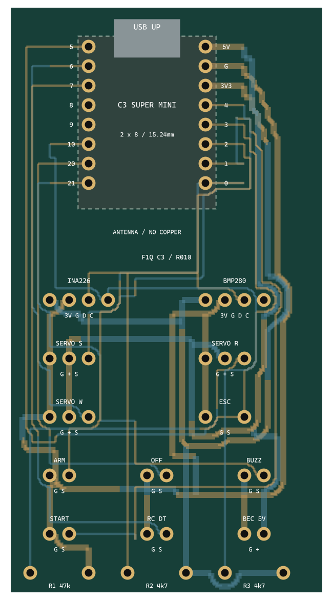

# VM-T1 F1Q: плата для ESP32-C3 Super Mini

Двухслойный прототип **40,64 × 76,2 мм**, FR-4 1,6 мм, медь 35 мкм.
Контроллер устанавливается непосредственно в **два разъёма 1×8**, расстояние между рядами 15,24 мм, шаг 2,54 мм.
Вид сверху: **USB вверх**, 5V в верхнем правом углу, GPIO5 — в верхнем левом.
[Источник геометрии, ориентация и таблица GPIO](../../docs/C3_GEOMETRY.md).

Штриховой контур показывает ориентировочный габарит модуля; точные посадочные размеры задаются центрами отверстий.
USB и положение контура относительно крайних выводов нужно сверить со своей ревизией платы; рисунок разъёма условный.
Между рядами и под центральной областью антенны задана зона без меди. Испытания радиосвязи не выполнены.

## Файлы

- `vm-t1-f1q-c3-v1.kicad_pro`, `.kicad_sch`, `.kicad_pcb` — проект, схема и разведённая плата KiCad 8.
- `VM_T1_C3.pretty`, `VM_T1_C3.kicad_sym`, таблицы библиотек — локальные библиотеки.
- `gerbers/`, `vm-t1-f1q-c3-v1-gerbers.zip` — Gerber и сверловка для пробного изготовления.
- `assembly.svg`, `assembly.png` — монтажный эскиз, построенный из координат платы.
- `drc.json`, `erc.json` — результаты проверок.

## Комплектующие и подключение

| Обозначение | Что установить / подключить |
|---|---|
| U1 | ESP32-C3 Super Mini, два гнезда 1×8, шаг 2,54 мм |
| J1 | INA226: слева направо 3V3, GND, SDA, SCL |
| J2 | BMP280: слева направо 3V3, GND, SDA, SCL |
| J3 / J4 / J5 | Servo S / R / W: GND, +5V, сигнал |
| J6 | ESC: GND и сигнал; средний контакт питания отсутствует |
| J7 / J8 | ARM / START: GND и сигнал |
| J9 / J10 | OFF / RC DT: GND и сигнал |
| J11 | Управляющий вход модуля активной пищалки: GND и сигнал; питание модуля отдельно |
| J12 | BEC: GND и стабилизированные +5V |
| R1 | 47 кОм, выводной, шаг 7,62 мм — подтяжка сигнала ESC к GND |
| R2 / R3 | 4,7 кОм, выводные, шаг 7,62 мм — подтяжки SDA/SCL к 3,3 В |

Если готовые датчики уже имеют подтяжки I²C, учесть их параллельное соединение: R2/R3 можно не устанавливать при наличии достаточных подтяжек на модулях. SDA GPIO2 должна иметь определённый высокий уровень при старте. Ориентир общего сопротивления подтяжек — 2,2–4,7 кОм; проверить фронты и обмен на своей проводке.

Светодиод используется встроенный в Super Mini. GPIO9/BOOT не подключён к периферии; оба отверстия GPIO8/9 присутствуют для штатной установки модуля. Датчики подключаются короткими проводами и закрепляются отдельно: геометрия их модулей не стандартизирована.

**Ток двигателя 7 А не проходит через эту плату.** Силовую цепь аккумулятор → R010 на INA226 → ESC выполнить отдельно подходящими проводами/контактами. 5V получает только выход BEC. Первоначально ограничить суммарный ток 5-вольтовых цепей платы до 1 А и проверить нагрев/просадки; мощные сервоприводы питать отдельной шиной с общей землёй. Нельзя соединять параллельно два выхода BEC или USB и внешнее питание без развязки.

На плате нет стабилизатора и защиты переполюсовки; монтажных отверстий нет. Использовать изолирующее крепление, исключить смещение модулей и контакт нижних выводов с проводкой. Для первого включения применять источник с ограничением тока.

## Проверки, 30 сентября 2026

- KiCad 8.0.2: **ERC 0, DRC 0, неподключённых цепей 0**.
- `tools/verify_c3.py`: проверены оба ряда 1×8, шаг и междурядье; 12 назначений GPIO без повторений; все 51 внешнее соединение схемы совпадают с фактической платой.
- Arduino CLI 0.35.3, Core 2.0.11: **806 276 байт Flash, 39 972 байта RAM**, успешная сборка. Осталось предупреждение Unicode старого генератора разделов Flash.
- Тесты расчёта энергии пройдены. Монтажный эскиз и экспорт платы просмотрены.

Эти проверки не подтверждают работу на оборудовании, тепловой режим, точность лимиттера или соответствие спортивным требованиям. До полётов выполнить [стендовые испытания](../../docs/F1Q.md). Это не одобренный EDIC лимиттер.

## Воспроизведение

Генератор `tools/generate_c3_carrier.py` запускается Python из KiCad 8. После генерации выполнить ERC/DRC, экспортировать netlist в формате `kicadxml`, затем запустить `tools/verify_c3.py <netlist.xml>` тем же Python. После изменений платы заново экспортировать Gerber и сверловку. Дорожки сигналов 0,3 мм, питания 0,8 мм, минимальный зазор 0,2 мм, сверловка выводов 1,0 мм, переходных отверстий 0,3 мм.
