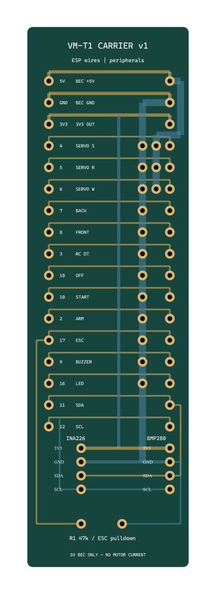

> Архивный прототип для ESP32-S3 с проводами. Для текущей ветки C3 используйте [c3-supermini-v1](../c3-supermini-v1/README.md).

# VM-T1: выводная плата-переходник v1

Инженерный прототип 30 × 100 мм, 2 слоя, FR-4 1,6 мм, медь 35 мкм. Датчики и ESP подключаются короткими проводами и крепятся отдельно. Это универсальная распайка, а не посадочные места конкретных модулей: покупать одинаковый вариант Arduino-модуля не требуется. Для установки непосредственно на плату нужны точные размеры ваших модулей.

- `vm-t1-carrier-v1.kicad_pro` — открыть в KiCad 8.
- `vm-t1-carrier-v1.kicad_sch` / `.kicad_pcb` — схема и разведённая плата.
- `VM_T1.pretty`, `VM_T1.kicad_sym` и таблицы библиотек — локальные библиотеки.
- `gerbers/` и `vm-t1-carrier-v1-gerbers.zip` — Gerber и сверловка прототипа.
- `assembly.svg` / `assembly.png` — монтажный эскиз сверху; координаты взяты из генератора платы.
- `drc.json`, `erc.json` — проверки KiCad, ноль нарушений; это не подтверждение работы устройства на стенде.

## Сборка

Слева J1 — отдельные провода к ESP (не стандартная гребёнка ESP32). Справа — провода к периферии. Для серво порядок слева направо GND / +5V / сигнал. Для кнопок — GND / сигнал. INA226 J19 и BMP280 J20: сверху вниз 3V3, GND, SDA, SCL, шаг 2,54 мм. Не переносить этот порядок без проверки на разъём самого модуля.

R1 — выводной резистор 47 кОм, шаг 7,62 мм; он подтягивает ESC к GND при старте процессора. Светодиод подключать через внешний 1 кОм; пищалку — через готовый драйвер. На плате нет стабилизатора, защиты переполюсовки и собственных подтяжек I²C: проверить наличие 3,3-вольтовых подтяжек на модулях.

Питание — стабилизированные 5 В от BEC. Для первого прототипа ограничить суммарную нагрузку шины BEC на плате до 1 А, проверить нагрев и просадки при работе серво. Более мощные сервоприводы питать отдельной проводной шиной с общей землёй. Силовую цепь аккумулятор → R010 → ESC прокладывать **вне этой платы**. На неё нельзя заводить ток двигателя 7 А или напряжение аккумулятора на шину 5 В.

Плату закреплять изолирующим креплением: монтажных отверстий нет. Оставить свободное пространство у антенны ESP и доступ воздуха к BMP280; исключить обдув винтом и свет на кристалл датчика. После изготовления проверить прозвонкой, затем запитать от источника с ограничением тока.

## Проверки и воспроизведение

Генератор: `tools/generate_carrier.py`, запуск Python из KiCad 8 с модулем pcbnew. После изменений повторить DRC/ERC, экспорт Gerber и сверловки. Текущая схема содержит разъёмы внешних модулей, а не их внутренние схемы. Проверены 59 соответствий контакт–цепь экспортированной схемы и платы. Зазор ≥0,2 мм, дорожки ≥0,3 мм, сверловка контактных площадок 0,9 мм; переходные отверстия 0,3 мм. DRC не проверяет силовую пригодность готового INA226-модуля.

Производственные файлы подготовлены для пробного экземпляра. Размеры модулей, пусковой ток, нагрев шунта и контактов ещё не подтверждены на вашем оборудовании. См. [подключение и испытания](../../docs/F1Q.md).
